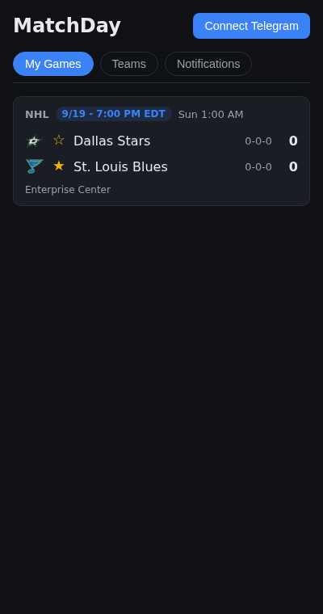
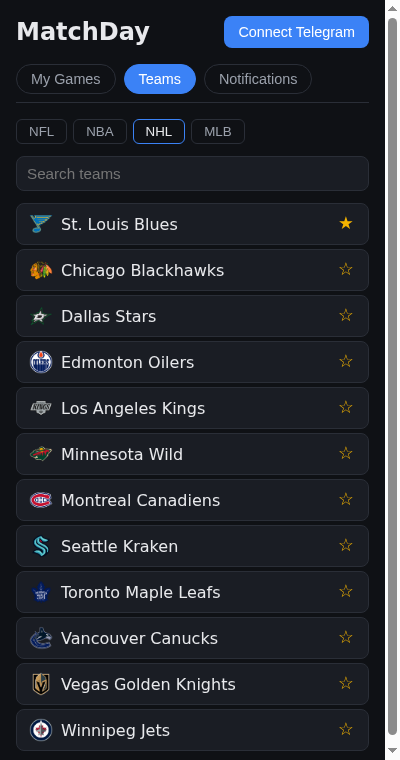

# MatchDay Alerts

[](../../actions/workflows/ci.yml)

Follow your teams across the NFL, NBA, NHL and MLB, see their games live on one page, and
get a Telegram message at kickoff and at the final score. No sign-up.

Final project for [AI Dev Tools Zoomcamp 2026](https://github.com/DataTalksClub/ai-dev-tools-zoomcamp/tree/main/project).
It grows the module 02 *ScoreFeed* homework into a production service, reusing the module 03
deployment and module 04 observability / incident-response patterns.

| Environment | URL | Upstreams |
|---|---|---|
| Production | `https://matchday.<EC2-IP>.sslip.io` | real ESPN, real Telegram bot |
| Dev | `https://dev.<EC2-IP>.sslip.io` | fake-espn (ESPN + Telegram stand-in), used for the incident demo |
| Grafana | `https://grafana.<EC2-IP>.sslip.io` | login required |
| Local | http://localhost:8080 · Grafana http://localhost:3000 | fake-espn |

<p>
  
  
</p>

---

## Contents

1. [Problem](#1-problem)
2. [Features and expected behavior](#2-features-and-expected-behavior)
3. [Quick start](#3-quick-start)
4. [Architecture](#4-architecture)
5. [Tech stack](#5-tech-stack)
6. [Repository structure](#6-repository-structure)
7. [API reference](#7-api-reference)
8. [Data model](#8-data-model)
9. [Configuration](#9-configuration)
10. [Testing](#10-testing)
11. [Containers](#11-containers)
12. [Deployment and CI/CD](#12-deployment-and-cicd)
13. [Observability](#13-observability)
14. [Alerting](#14-alerting)
15. [On-call agent](#15-on-call-agent)
16. [Agent team, spec and context](#16-agent-team-spec-and-context)
17. [Reviewer checklist (all 12 criteria)](#17-reviewer-checklist-all-12-criteria)
18. [Project status](#18-project-status)
19. [Makefile commands](#19-makefile-commands)
20. [Troubleshooting](#20-troubleshooting)
21. [Documentation index](#21-documentation-index)

---

## 1. Problem

Fans who follow a few teams across leagues must open a sports app and dig through every
league's scoreboard to learn whether their team plays today, whether the game has started,
and how it ended. Generic apps need an account, push far too much, and bury the one score
that matters.

**Users**
- **Fan** — follows 1–10 teams, checks scores on a phone, wants a ping at kickoff and at the
  final whistle, nothing else.
- **Operator** — runs the service on one EC2 host, needs to know when fans stop getting scores
  or notifications, and wants an agent to fix routine breakage (ESPN schema changes).

**Out of scope:** password accounts, play-by-play, odds, channels other than Telegram, leagues
beyond the four above, LLM-generated content.

## 2. Features and expected behavior

Full stories with Given/When/Then acceptance criteria: [`docs/product/spec.md`](docs/product/spec.md).

| Story | Feature | Expected behavior |
|---|---|---|
| S1 | Anonymous identity | First request creates a user and sets an HttpOnly `md_uid` cookie; no sign-up |
| S2 | Browse and follow teams | Team list per league with search; follow/unfollow with a star; idempotent; followed teams listed first |
| S3 | **My Games** (key journey) | Today's games of followed teams, any league, live score/period/clock, refreshed every 15 s, paused in background tabs. ESPN down → last known scores + "out of date" banner; nothing cached → error message |
| S4 | Connect Telegram | *Connect Telegram* opens `t.me/<bot>?start=<one-time token>` (15 min, single use); bot replies "Connected"; `/stop` or *Disconnect* unlinks |
| S5 | Game notifications | Worker polls ESPN for followed leagues; `pre→in` sends "🟢 Kickoff: DAL @ STL (NHL)", `in→post` (or `pre→post`) sends "🏁 Final: DAL 2 – 3 STL (NHL)"; at most once per fan/game/kind; 3 delivery attempts with backoff; no back-fill after downtime |
| S6 | Notification history | Last 50 notifications with Delivered / Sending… / Failed |
| S7 | Operability | `/api/health`, `/api/ready`, `/api/version`; telemetry; alerts; on-call agent |
| S8 | Daily digest | *Stretch — not implemented* |

## 3. Quick start

**Requirements:** Docker with Compose v2. For running tests outside Docker: [`uv`](https://docs.astral.sh/uv/) and Node 22.

```sh
git clone <this repo> && cd matchday
make up          # = docker compose up --build -d --wait
```

This starts 11 containers: postgres, fake-espn, api, worker, frontend, otel-collector,
prometheus, loki, tempo, grafana, alert-bridge.

| URL | What |
|---|---|
| http://localhost:8080 | MatchDay app |
| http://localhost:3000 | Grafana, home dashboard **MatchDay** (anonymous admin locally) |
| http://localhost:9090 | Prometheus |
| http://localhost:8090/_control | fake-espn state (game overrides, drift mode) |
| http://localhost:8095/incidents | alert-bridge incidents |

**Try the whole journey locally (≈ 2 minutes)**

1. Open http://localhost:8080 → **Teams** → **NHL** → star **St. Louis Blues** → **My Games**:
   the DAL @ STL game appears (scheduled).
2. `make demo-live` → within ~15 s the card shows **LIVE 1–0**, no reload.
3. Connect Telegram locally (the fake bot): press **Connect Telegram**, copy the `start=` token
   from the opened URL, then
   `curl -XPOST localhost:8090/_control/telegram/updates -H 'content-type: application/json' -d '{"chat_id":1,"text":"/start <token>"}'`
   (the e2e test does exactly this).
4. `make demo-final` → **FINAL 3–2**; `curl localhost:8090/_control/telegram/messages` shows the
   kickoff and final messages, each once; the **Notifications** tab shows them as Delivered.
5. `make demo-drift` → ESPN "changes" its schema → about a minute later the Grafana alert
   **ESPN scoreboard schema drift** fires → `curl localhost:8095/incidents` shows an incident
   with collected context. `make demo-reset` restores.

Use the real ESPN API locally: `ESPN_BASE_URL=https://site.api.espn.com/apis/site/v2/sports make up`.
Stop everything: `make down`.

## 4. Architecture

```
                          ┌──────────────────────── EC2 host ────────────────────────────┐
 browser ─HTTPS─► Caddy ─►│ frontend (nginx + React) ─/api─► api (FastAPI) ─► Postgres    │
                          │                                   │  ▲                       │
 ESPN scoreboard API ◄────┼───────────────────────────────────┤  │ TTL + stale cache     │
                          │ worker: poll 30 s → detect pre→in / in→post → outbox ─────────┼─► Telegram Bot API
 Telegram ─webhook────────┼─► api /api/telegram/webhook (secret header)                  │
                          │                                                               │
                          │ api, worker ─OTLP─► otel-collector (redact) ─► Prometheus     │
                          │                                             ─► Loki   ─► Grafana
                          │                                             ─► Tempo          │
                          │ Grafana alert ─webhook─► alert-bridge ─repository_dispatch────┼─► GitHub Actions
                          └───────────────────────────────────────────────────────────────┘   oncall.yml: Claude Code
                                                                                                → fix PR → CI → dev → prod
```

- **api** and **worker** are the same image (`matchday` package), two processes.
- **ESPN** is unofficial and unreliable: 5 s timeout, 15 s TTL cache, stale cache on failure,
  one malformed event never breaks a response.
- **Notifications** use a transactional outbox with a unique `(user, game, kind)` constraint
  ([ADR-002](docs/decisions/ADR-002-notification-outbox.md)).
- **fake-espn** replaces ESPN and Telegram in tests, locally, in CI and on dev
  ([ADR-001](docs/decisions/ADR-001-one-fake-for-all-upstreams.md)).
- **On-call** runs in GitHub Actions and fixes land as PRs
  ([ADR-003](docs/decisions/ADR-003-oncall-agent-in-github-actions.md)).

More: [`docs/architecture.md`](docs/architecture.md).

## 5. Tech stack

| Area | Technology |
|---|---|
| Backend | Python 3.12, FastAPI, SQLAlchemy 2.0 (async), Alembic, httpx, asyncpg, `uv` |
| Frontend | React 19, TypeScript, Vite, plain CSS, served by nginx |
| Database | PostgreSQL 16 (SQLite only for fast local unit tests) |
| Notifications | Telegram Bot API (webhook in prod, long polling locally/dev) |
| Tests | pytest + pytest-asyncio, Vitest + React Testing Library, Playwright |
| Containers | Docker, Docker Compose (`include`, profiles, healthchecks) |
| Hosting | AWS EC2, Caddy (automatic HTTPS via sslip.io), GHCR images |
| CI/CD | GitHub Actions (CI, CD to dev, manual prod with approval, on-call) |
| Observability | OpenTelemetry SDK + auto-instrumentation, OTel Collector, Prometheus, Loki, Tempo, Grafana |
| AI tooling | Claude Code: subagent team (`.claude/agents/`), headless on-call agent (`claude -p`) |

## 6. Repository structure

```
matchday/
├── AGENTS.md                 # entry point for every agent (CLAUDE.md → AGENTS.md)
├── README.md                 # this file
├── Makefile                  # up, down, test, e2e, demo-* (see §19)
├── compose.yaml              # full local system; includes observability/compose.yaml
├── .claude/agents/           # 7 subagent roles: product-owner, architect, backend-dev,
│                             #   frontend-dev, qa, devops, reviewer
├── .github/
│   ├── ISSUE_TEMPLATE/story.yml      # story + Given/When/Then AC checkboxes
│   ├── pull_request_template.md      # Closes #, AC checklist, checks
│   └── workflows/
│       ├── ci.yml            # every PR: lint, unit, integration (Postgres), frontend, e2e
│       ├── cd-dev.yml        # green main → build images → deploy dev
│       ├── deploy-prod.yml   # manual, approval, any existing tag (= rollback)
│       ├── _deploy.yml       # reusable deploy: Caddy, telemetry stack, app, smoke test
│       └── oncall.yml        # alert → Claude Code → fix PR / issue
├── backend/
│   ├── src/matchday/
│   │   ├── main.py           # FastAPI app, health/ready/version
│   │   ├── routers/          # follows.py (teams, follows, my-games), account.py
│   │   │                     #   (me, telegram link/webhook, notifications), scoreboard.py
│   │   ├── identity.py       # anonymous cookie user
│   │   ├── espn_client.py    # ESPN HTTP client
│   │   ├── normalizer.py     # ESPN JSON → Game / TeamInfo (+ parsed/dropped counts)
│   │   ├── scoreboard_service.py  # TTL + stale cache, schema-error detection
│   │   ├── worker.py         # poll loop, transitions, outbox sender, Telegram polling
│   │   ├── notifier.py       # transition rules + message text (pure)
│   │   ├── telegram.py       # Bot API client, /start /stop handling
│   │   ├── telemetry.py      # OTel setup, instruments, JSON logs
│   │   ├── models.py · schemas.py · db.py · config.py · cache.py
│   ├── migrations/           # Alembic (initial schema)
│   ├── tests/unit/           # normalizer, notifier
│   ├── tests/integration/    # follows/my-games, telegram, worker, telemetry, scoreboard
│   ├── tests/fixtures/       # recorded real ESPN responses (nfl, nba, nhl, mlb)
│   └── Dockerfile
├── frontend/
│   ├── src/components/       # MyGames, TeamPicker, Notifications, TelegramConnect,
│   │                         #   GameCard, FollowStar, StatusBadge, AppTabs (+ *.test.tsx)
│   ├── src/context/FollowsContext.tsx · src/hooks/usePolling.ts · src/api.ts · src/types.ts
│   ├── nginx.conf · Dockerfile
├── e2e/tests/key-journey.spec.ts     # Playwright, Pixel 7 viewport
├── fake-espn/app.py          # ESPN + Telegram stand-in with control API and DRIFT modes
├── alert-bridge/             # Grafana webhook → telemetry context → repository_dispatch
├── observability/            # collector, Prometheus, Loki, Tempo, Grafana (dashboard, alerts)
├── deploy/                   # EC2: bootstrap.sh, deploy.sh, compose.app/edge/ops, Caddyfile
├── scripts/bootstrap-github.sh       # labels, milestones, issues from spec, project board
└── docs/                     # see §21
```

## 7. API reference

All endpoints are under `/api`; identity comes from the `md_uid` cookie (created on first call).

| Method | Path | Description |
|---|---|---|
| GET | `/health` | Liveness: `{"status":"ok"}` |
| GET | `/ready` | Readiness: 200 if the DB answers, else 503 |
| GET | `/version` | `{"sha": "<git short sha>"}` (used by deploy smoke tests) |
| GET | `/me` | `{"telegram_connected": bool, "follows": int}` |
| GET | `/teams/{league}` | Teams of `nfl\|nba\|nhl\|mlb` (24 h cache); 422 for unknown league |
| GET | `/follows` | Current user's follows |
| POST | `/follows` | Body `{"league","team_id"}`; idempotent; 404 for unknown team |
| DELETE | `/follows/{league}/{team_id}` | Unfollow; always 204 |
| GET | `/my-games` | `{"games":[Game], "stale": bool, "fetched_at"}`; 502 if a followed league is unavailable and uncached |
| GET | `/scoreboard/{league}` | Raw normalized league scoreboard (from ScoreFeed) |
| POST | `/telegram/link` | `{"url": "https://t.me/<bot>?start=<token>"}` |
| DELETE | `/telegram/link` | Disconnect Telegram; 204 |
| POST | `/telegram/webhook` | Telegram updates; requires `X-Telegram-Bot-Api-Secret-Token`, else 401 |
| GET | `/notifications` | Last 50 notifications: kind, text, status, timestamps |

Interactive docs: http://localhost:8080/api/docs is not proxied; use `docker compose exec api`
or run the backend directly (`uv --directory backend run uvicorn matchday.main:app --port 8001`)
and open http://localhost:8001/docs.

## 8. Data model

```
users(id uuid, created_at)
follows(id, user_id → users, league, team_id, team_name, abbreviation, logo, created_at)
        unique(user_id, league, team_id)
telegram_chats(user_id → users PK, chat_id unique, linked_at)
telegram_links(token PK, user_id → users, expires_at, used_at)
game_snapshots(game_id PK, league, state, home_abbr, away_abbr, home_score, away_score,
               start_time, updated_at)
notifications(id, user_id → users, game_id, league, kind, text, status, attempts,
              next_attempt_at, created_at, sent_at)   unique(user_id, game_id, kind)
```

Migrations: `backend/migrations/` (Alembic). The api container runs `alembic upgrade head` on
start; CI checks `alembic check` (models and migrations agree). Migrations are expand-only so
the previous release can always run against the newer schema (rollback safety).

## 9. Configuration

Backend (env vars; defaults in `backend/src/matchday/config.py`):

| Variable | Default | Purpose |
|---|---|---|
| `DATABASE_URL` | `sqlite+aiosqlite:///./matchday.db` | `postgresql+asyncpg://…` in compose/prod |
| `ESPN_BASE_URL` | real ESPN | fake-espn locally/dev |
| `SCOREBOARD_CACHE_TTL_SECONDS` | 15 | 2 locally, 3 on dev |
| `POLL_INTERVAL_SECONDS` | 30 | worker poll; 3 locally, 5 on dev |
| `TELEGRAM_API_BASE` | `https://api.telegram.org` | fake-espn `/telegram` locally/dev |
| `TELEGRAM_BOT_TOKEN` / `TELEGRAM_BOT_USERNAME` | — | from @BotFather (prod) |
| `TELEGRAM_WEBHOOK_SECRET` | — | checked on `/api/telegram/webhook` |
| `TELEGRAM_MODE` | `webhook` | `polling` = worker calls `getUpdates` (local/dev) |
| `COOKIE_SECURE` | false | true behind HTTPS |
| `GIT_SHA` | `dev` | baked into the image at build |
| `OTEL_EXPORTER_OTLP_ENDPOINT` | unset | enables telemetry export |
| `OTEL_RESOURCE_ATTRIBUTES` | — | `deployment.environment=local\|dev\|prod` |

alert-bridge: `GRAFANA_URL`, `GRAFANA_PASSWORD`, `ALERT_WEBHOOK_TOKEN`, `GITHUB_REPOSITORY`,
`GITHUB_DISPATCH_TOKEN` (empty = dry-run). GitHub secrets and variables: [`docs/deployment.md`](docs/deployment.md#one-time-setup).

## 10. Testing

| Level | Count | Where | Runs against |
|---|---|---|---|
| Backend unit | 19 | `backend/tests/unit/` | pure Python |
| Backend integration | 34 | `backend/tests/integration/` | Postgres (CI, `make test-backend-pg`) or SQLite; fake-espn in-process |
| alert-bridge | 5 | `alert-bridge/tests/` | mocked Grafana/GitHub |
| Frontend | 33 | `frontend/src/**/*.test.tsx` | Vitest + RTL + jsdom |
| E2E | 2 | `e2e/tests/key-journey.spec.ts` | Playwright against `make up` |

What the integration tests cover: cookie identity, follow idempotency and isolation between
users, My Games filtering, stale cache, 502 on outage and on unparseable upstream, Telegram link
expiry/single use/webhook auth, transitions, no back-fill, exactly-once across restarts,
retries → failed, history, **trace coverage of the key journey and a privacy test** that no
cookie id, chat id, token or secret reaches spans or logs.

E2E: (1) follow STL → the live score updates on the page without reload; (2) connect Telegram →
kickoff and final delivered exactly once → visible in Notifications.

```sh
make test              # backend + alert-bridge + frontend (no Docker needed)
make test-backend-pg   # backend against a throwaway Postgres container
make up && make e2e    # first time: npm --prefix e2e ci && npm --prefix e2e run install-browsers
```

Test names map to stories (`test_s5_kickoff_and_final_are_sent_once`). More: [`docs/testing.md`](docs/testing.md).

## 11. Containers

| Image | Dockerfile | Notes |
|---|---|---|
| backend | `backend/Dockerfile` | uv, non-root; default cmd = migrate + uvicorn; worker overrides cmd |
| frontend | `frontend/Dockerfile` | Vite build → nginx; proxies `/api` with re-resolving DNS |
| fake-espn | `fake-espn/Dockerfile` | fixtures baked in (repo-root context) |
| alert-bridge | `alert-bridge/Dockerfile` | non-root, incidents volume |

`compose.yaml` starts everything including the database and the telemetry stack with one
command, with healthchecks and ordered startup (postgres → api runs migrations → worker, frontend).

## 12. Deployment and CI/CD

```
PR ─► CI: ruff · pytest on Postgres · alembic check · alert-bridge tests
        · frontend lint/test/build · compose + Playwright e2e
merge to main ─► CI ─► CD (dev): build backend/frontend/fake-espn/alert-bridge images
                         → ghcr.io/<owner>/matchday/*:sha-<short>
                         → ssh: Caddy · telemetry stack · deploy.sh dev <tag> · public smoke test
owner ─► "Deploy production" (tag) ─► approval ─► deploy.sh prod <tag> · Telegram setWebhook · smoke test
```

- **One EC2 host**, Docker networks `edge` (Caddy ↔ frontends, Grafana) and `ops` (apps → collector).
  Projects: `matchday-edge`, `matchday-dev`, `matchday-prod`, `matchday-ops`.
- **`deploy/deploy.sh <env> <tag>`**: pull → `up --wait` → check `/api/version` equals the
  tag → record `last_good_tag`; on failure **automatic rollback** to the last good tag.
- **Manual rollback:** run *Deploy production* with the previous tag
  (`/opt/matchday/prod/previous_good_tag`, `deploy_history`).
- **One-time setup** (EC2 bootstrap, deploy key, GitHub secrets/variables/environments,
  GHCR visibility): [`docs/deployment.md`](docs/deployment.md#one-time-setup).

## 13. Observability

The key journey **follow team → see live score** has all three signals, correlated by trace id:

| Signal | Content |
|---|---|
| Traces | `GET /api/my-games` → `SELECT …` (SQLAlchemy) → `GET` ESPN (httpx); worker: `worker cycle` → `game transition` → `notification send` → `telegram sendMessage` |
| Metrics | `http_server_request_duration_seconds{http_route,http_response_status_code}`, `matchday_espn_requests_total`, `matchday_scoreboard_events_total{outcome=parsed\|dropped}`, `matchday_notifications_total`, `matchday_notification_latency_seconds`, `matchday_worker_cycles_total` |
| Logs | JSON with `trace_id`/`span_id`, e.g. `my-games served follows=1 leagues=nhl games=1 stale=False` |

Grafana dashboard **MatchDay** (env selector, 9 panels, logs panel with **View trace** links;
traces link back to logs and metrics). Every signal has `service_name` and `deployment_environment`.

**Privacy:** no cookie ids, chat ids, link tokens, bot token or webhook secret in telemetry. The
Telegram client is not auto-instrumented (its URL contains the token), noisy loggers are capped
at WARNING, the collector redacts as a backstop, and `test_telemetry.py` enforces it.


More: [`docs/observability.md`](docs/observability.md).

## 14. Alerting

Alerts measure what fans experience, not CPU. All are provisioned from
[`alerts.yaml`](observability/grafana/provisioning/alerting/alerts.yaml), grouped by environment,
and routed to the `oncall-agent` contact point (webhook with Bearer token).

| Alert | Fires when | Fan impact |
|---|---|---|
| Fans can't load live scores | any 5xx on `GET /api/my-games` in 5 min | error instead of scores |
| ESPN scoreboard schema drift | > 20 % of a league's events unparseable for 1 min | missing/stale scores, no notifications |
| Telegram notifications failing | any failed or retried delivery in 10 min | missed kickoff/final messages |

Each alert carries the endpoint, window, a runbook link and a dashboard link.
Runbook per alert: [`docs/runbook.md`](docs/runbook.md).

## 15. On-call agent

```
Grafana alert ─► alert-bridge: collects 15 min of metrics tables, warn/error logs with
                 trace ids and failing traces → context.md ─► repository_dispatch "incident"
             ─► .github/workflows/oncall.yml:
                 claude -p docs/oncall-prompt.md   (tools: read/edit, pytest, ruff only)
                 1 triage → 2 reproduce in a failing test → 3 fix → 4 tests + ruff → 5 response.md
                 workflow: tests again · path guard rail (backend/, docs/incidents/ only)
                 STATUS: FIXED → PR labelled "incident"; otherwise → issue
PR ─► CI ─► review/merge ─► CD to dev ─► alert resolves ─► owner promotes to prod
```

The agent never pushes, deploys or touches production. Demo scenario: `DRIFT=renamed_competitors`
on dev renames `competitors` → `teams` in ESPN's response; the agent should make the
normalizer accept both shapes and add a drift fixture test.

Local evidence so far: [`docs/incidents/2026-10-23-local-drift-dry-run/`](docs/incidents/2026-10-23-local-drift-dry-run/)
(alert fired → bridge context collected).

## 16. Agent team, spec and context

- **Spec:** [`docs/product/spec.md`](docs/product/spec.md) — problem, users, 8 stories, Given/When/Then
  ACs, non-functional requirements. Public tracker: GitHub Issues + project board generated
  from the spec by [`scripts/bootstrap-github.sh`](scripts/bootstrap-github.sh).
- **Team:** [`docs/team.md`](docs/team.md) — 7 subagents in [`.claude/agents/`](.claude/agents/) plus the
  on-call agent; each has responsibilities, owned files and a hand-off artifact.
- **Process:** [`docs/process.md`](docs/process.md) — issue (ready) → architect plan comment → QA
  writes failing tests from ACs → dev implements → PR with AC checklist → CI → reviewer agent →
  merge → dev → manual prod. Definition of Ready / Done included.
- **Context:** [`AGENTS.md`](AGENTS.md) (symlinked as `CLAUDE.md`) — stack, commands, rules, and a
  table telling each agent which modular doc to read for its task.

## 17. Reviewer checklist (all 12 criteria)

| # | Criterion (max) | Where to look | How to verify |
|---|---|---|---|
| 1 | Problem description (2) | §1–2, [`spec.md`](docs/product/spec.md) | Read |
| 2 | Product specification (2) | [`spec.md`](docs/product/spec.md), [Issues](../../issues), [Projects](../../projects), [`story.yml`](.github/ISSUE_TEMPLATE/story.yml) | Issues have AC checkboxes; PRs reference them |
| 3 | Agent team (2) | [`team.md`](docs/team.md), [`process.md`](docs/process.md), [`.claude/agents/`](.claude/agents/) | Roles, ownership, process defined |
| 4 | Context management (2) | [`AGENTS.md`](AGENTS.md) → [`docs/`](docs/) | AGENTS.md links to modular docs |
| 5 | Application (2) | §3–8 | `make up`, then the 5-step journey in §3 |
| 6 | Testing (2) | §10 | `make test` (91 tests), `make e2e` (2) |
| 7 | Containerization (2) | §11, [`compose.yaml`](compose.yaml) | `make up` starts all 11 services incl. DB |
| 8 | Deployment (2) | URLs at the top, [`deployment.md`](docs/deployment.md) | Open the prod URL |
| 9 | CI/CD (3) | §12, [`.github/workflows/`](.github/workflows/) | Actions tab: CI on PRs, CD (dev) on main, Deploy production with approval |
| 10 | Observability (2) | §13, [`observability.md`](docs/observability.md) | Grafana → MatchDay; log line → View trace; privacy test |
| 11 | Alerting (1) | §14, [`alerts.yaml`](observability/grafana/provisioning/alerting/alerts.yaml) | `make demo-drift` → alert fires |
| 12 | On-call agent (2) | §15, [`oncall.yml`](.github/workflows/oncall.yml), [`alert-bridge/`](alert-bridge/), [`docs/incidents/`](docs/incidents/) | Incident record with the agent's PR |

## 18. Project status

| Area | Status |
|---|---|
| App (S1–S6), tests, containers, local telemetry, alerts, alert-bridge | ✅ Done and verified locally (2026-10-26: `make test` 91 tests, `make e2e` 2, `make up` 11 healthy services) |
| S8 daily digest | ⏸ Not implemented (stretch) |
| GitHub repo | ✅ Created and pushed |

**Known limitations**
- Final notifications can arrive up to ~45 s after ESPN changes state in prod (30 s poll + 15 s cache).
- A crash between Telegram `sendMessage` and the status update can re-send one message.
- Identity is a browser cookie: clearing cookies or switching devices starts a new, empty
  user (a chat can be linked to one user at a time; the latest link wins).
- Dev uses fake upstreams, so it shows recorded games, not today's.

## 19. Makefile commands

| Command | Does |
|---|---|
| `make up` / `make down` | Start / stop the full local system |
| `make logs` | Follow api and worker logs |
| `make test` | Backend + alert-bridge + frontend tests |
| `make test-backend` · `make test-bridge` · `make test-frontend` | One suite |
| `make test-backend-pg` | Backend suite on a throwaway Postgres |
| `make lint` | ruff + oxlint |
| `make e2e` | Playwright against the running stack |
| `make demo-live` · `make demo-final` | Set game DAL @ STL live 1–0 / final 3–2 in fake-espn |
| `make demo-drift` · `make demo-reset` | Break / restore the ESPN schema in fake-espn |

## 20. Troubleshooting

| Symptom | Fix |
|---|---|
| Port 8080/3000/9090/8090/8095 in use | `APP_PORT=8081 GRAFANA_PORT=3001 make up` (also `PROMETHEUS_PORT`, `FAKE_ESPN_PORT`, `BRIDGE_PORT`) |
| `make e2e` fails with "Executable doesn't exist" | `npm --prefix e2e ci && npm --prefix e2e run install-browsers` |
| My Games empty right after `make demo-*` | Wait one cache TTL + poll (≈ 5 s locally) |
| Grafana panels "No data" | Generate traffic (use the app or `make e2e`); metrics export every 5 s locally |
| Alert never fires after `make demo-drift` | Follow at least one NHL team first (the worker only polls followed leagues); wait ~1–2 min |
| Telegram link stays "not connected" locally | The worker reads the fake's `getUpdates`; check `make logs` for `telegram command handled` |

## 21. Documentation index

| Doc | Content |
|---|---|
| [`AGENTS.md`](AGENTS.md) | Agent entry point: stack, commands, rules, doc map |
| [`docs/product/spec.md`](docs/product/spec.md) | Problem, users, stories, acceptance criteria |
| [`docs/team.md`](docs/team.md) | Agent roles, ownership, hand-offs |
| [`docs/process.md`](docs/process.md) | Workflow, Definition of Ready / Done |
| [`docs/architecture.md`](docs/architecture.md) | Components, API contract, data model, worker cycle |
| [`docs/testing.md`](docs/testing.md) | Test levels, fake-espn control API |
| [`docs/deployment.md`](docs/deployment.md) | Environments, pipeline, rollback, one-time setup |
| [`docs/observability.md`](docs/observability.md) | Signals, correlation, privacy, alerts |
| [`docs/runbook.md`](docs/runbook.md) | Incident flow, per-alert procedures |
| [`docs/oncall-prompt.md`](docs/oncall-prompt.md) | The on-call agent's instructions |
| [`docs/decisions/`](docs/decisions/) | ADR-001 fakes · ADR-002 outbox · ADR-003 on-call in Actions |
| [`docs/incidents/`](docs/incidents/) | Incident records |
